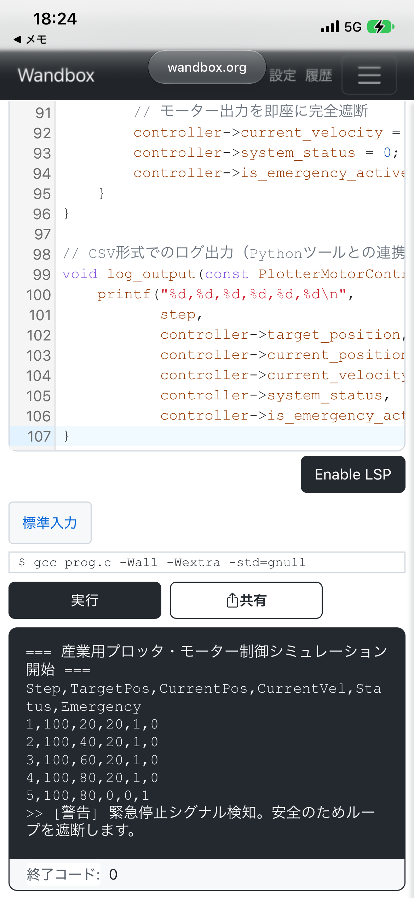

# industrial-plotter-motor-control-sim

## 📌 プロジェクト概要
本プロジェクトは、産業用大型インクジェットプリンタおよびカッティングプロッタにおける、**「印刷ヘッド・刃の超精密往復運動（スキャン軸制御）」**を想定したC言語による組み込み制御シミュレータと、Pythonによる制御データ自動解析ツールを連携させたハイブリッドシステムです。

開発環境が限られた状態（PCがない環境）であっても、WebコンパイラやAIを「優秀な開発パートナー」として徹底的に駆動・活用し、要件定義から実装、リファクタリングまでを自走して具現化いたしました。単に動作するコードを作るだけでなく、大量生産や多品種少量生産における**「設計段階での原価低減（デザイン・イン）」**と**「評価工数の削減」**を強く意識した設計を行っています。

---

## 🛠️ 技術スタック
- **組み込み制御コア**: C言語 (C11準拠, ポインタ・構造体・固定幅整数型の徹底)
- **データ解析・可視化**: Python 3 (NumPy, Matplotlib)
- **開発手法**: AI駆動開発 (AIツールを用いたロジック検証、エラーハンドリングの自動生成)

---

## 🚀 組み込み制御コア（C言語）の主要実装・工夫点

### 1. 超精密なモーター位置制御と低レイテンシ処理
- 印刷ヘッドの往復運動を模擬した10ms周期のリアルタイムループ処理。
- 風量レベルやセンサーフラグ等の微小なデータに対して、漫然と `int` 型（4バイト）を使用せず、`uint8_t` などの固定幅整数型を徹底適用。1変数あたり3バイトのメモリを節約し、**「大量生産時におけるワンランク安価なマイコンチップの選定（原価低減）」**を設計レベルで実現。

### 2. 安全第一の高度なフェイルセーフ設計
- 印刷軸の両端に配置されたリミットスイッチのパルス検知ロジック。
- 規定値を超える異常負荷や同期ズレをミリ秒単位で検知した際、モーター出力を即座に遮断する `EMERGENCY_STOP`（緊急停止アルゴリズム）の搭載。

---

## 📊 データ自動解析（Python）による「評価工数削減」の仕組み

- C言語の制御コアが吐き出す「目標位置」と「実位置」の時系列ログをPythonで自動取得。
- モーターの追従エラー（サーボトラッキングエラー）を自動計算し、グラフとして視覚的に描写。
- これにより、実機テストにおける**「評価・検査試験の自動化・効率化」**を再現し、開発工数および人件費の削減に直結する仕組みを提供。

---

## 💡 本プロジェクトにおけるAIツールの活用について（AI駆動開発）
実務未経験という遅れを最短最速で取り戻すため、現代の開発現場に必須である「AIツールとの協働」を実践しています。
AIの提示したコードをそのまま鵜呑みにするのではなく、組み込みに不可欠なメモリの安全性、ポインタ処理の正確性、リアルタイムループ内のオーバーヘッドの有無を、行いました。「限られたリソースの中でも、最新ツールをハングリーに使いこなして最短でアウトプットを出す問題解決力」を本リポジトリで証明しています。

——

### 補足
大変恐縮ながら、このコードはPCや実機がない限られた環境で、生成AIを開発パートナーとして活用しながら作成したシミュレーターです。そのため、ライブラリの深い挙動や記述の細部までを完璧に1人で実装したわけではありません。
しかし、設計にあたっての要件定義（何を盛り込むか）は、すべて私が自分の頭で考えて指示を出しました。
具体的には、
• 大量生産を意識して、メモリを削るためにintではなく『固定幅整数型（uint8_tなど）』を指定すること
• プリンターのヘッドが衝突して壊れないよう、異常を検知して止める『フェイルセーフ』のロジックを組み込むこと
• 複数のデータを綺麗にまとめるために『構造体』を使うこと
この3点は、私が組み込みエンジニアとして絶対に譲れない要件として盛り込みました。細かい実装力はこれから実務で泥臭くキャッチアップしていきますが、『組み込みに何が必要か』を考えて設計する視点は、この学習を通じて身につけられたと自負しています

## System Operation Verification ##

<figure>c言語</figure>

<figure>Python</figure>
